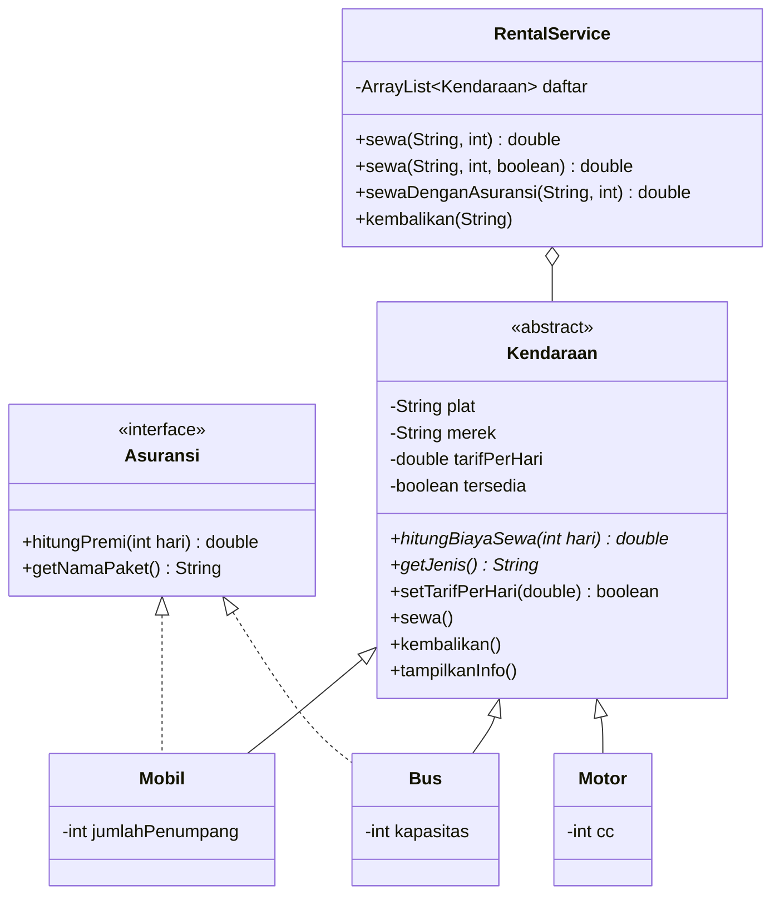
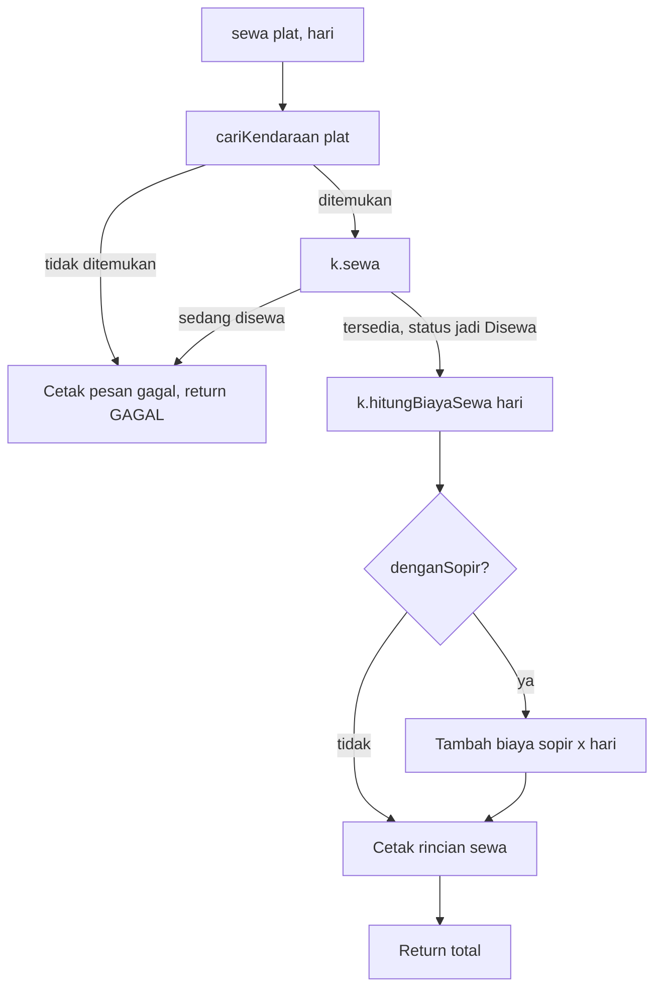

# Sistem Rental Kendaraan (Java OOP)

Aplikasi console sederhana untuk menyewakan berbagai jenis kendaraan (mobil, motor, bus). Proyek ini dibuat untuk menerapkan lima konsep OOP wajib: **Encapsulation, Inheritance, Polymorphism, Abstract Class, dan Interface**.

**Cara menjalankan**

```bash
javac *.java
java Main
```

---

## 1. Struktur Package

Proyek ini **tidak memakai `package`** (default package). Semua file `.java` berada dalam satu folder yang sama.

```
RentalKendaraan/
├── Asuransi.java        (interface)
├── Kendaraan.java       (abstract class / superclass)
├── Mobil.java           (subclass, implements Asuransi)
├── Motor.java           (subclass)
├── Bus.java             (subclass, implements Asuransi)
├── RentalService.java   (logika penyewaan)
├── Main.java            (program utama / demo)
└── README.md
```

### Hubungan antar class



| File | Jenis | Peran |
|---|---|---|
| `Asuransi.java` | Interface | Kontrak untuk kendaraan yang bisa diasuransikan |
| `Kendaraan.java` | Abstract class | Superclass: data dan perilaku umum semua kendaraan |
| `Mobil.java` | Class | Subclass `Kendaraan`, implements `Asuransi` |
| `Motor.java` | Class | Subclass `Kendaraan` (tanpa asuransi) |
| `Bus.java` | Class | Subclass `Kendaraan`, implements `Asuransi` |
| `RentalService.java` | Class | Mengelola daftar kendaraan, proses sewa dan pengembalian |
| `Main.java` | Class | Titik masuk program, mendemokan semua konsep |

---

## 2. Penerapan Konsep di Kode

### 2.1 Encapsulation

| File | Lokasi | Penjelasan |
|---|---|---|
| `Kendaraan.java` | atribut `plat`, `merek`, `tarifPerHari`, `tersedia` | Semua bersifat `private`, tidak bisa diakses langsung dari luar class |
| `Kendaraan.java` | `getPlat()`, `getMerek()`, `getTarifPerHari()`, `isTersedia()` | Getter untuk membaca data |
| `Kendaraan.java` | `setTarifPerHari(double)` | Setter dengan validasi: nilai ≤ 0 ditolak, tarif lama dipertahankan, mengembalikan `false` |
| `Kendaraan.java` | constructor `Kendaraan(...)` | Menolak tarif awal ≤ 0 dengan `IllegalArgumentException` |
| `Kendaraan.java` | `sewa()` dan `kembalikan()` | Status `tersedia` hanya bisa berubah lewat dua method ini |
| `Mobil.java` | `jumlahPenumpang`, `getJumlahPenumpang()` | Atribut private + getter |
| `Motor.java` | `cc`, `getCc()` | Atribut private + getter |
| `Bus.java` | `kapasitas`, `getKapasitas()` | Atribut private + getter |
| `RentalService.java` | `daftar`, `BIAYA_SOPIR_PER_HARI` | Private; diakses lewat `tambahKendaraan()` dan `cariKendaraan()` |

### 2.2 Inheritance

| File | Lokasi | Penjelasan |
|---|---|---|
| `Mobil.java` | `class Mobil extends Kendaraan` | Subclass 1 |
| `Motor.java` | `class Motor extends Kendaraan` | Subclass 2 |
| `Bus.java` | `class Bus extends Kendaraan` | Subclass 3 |
| `Mobil.java`, `Motor.java`, `Bus.java` | constructor masing-masing | Memanggil `super(plat, merek, tarifPerHari)` untuk mengisi atribut milik superclass |
| `Mobil.java`, `Motor.java`, `Bus.java` | `tampilkanInfo()` | Memanggil `super.tampilkanInfo()` lalu menambahkan info khusus subclass |

### 2.3 Polymorphism

**Method Overriding (`@Override`)**

| File | Method yang di-override |
|---|---|
| `Mobil.java` | `hitungBiayaSewa()`, `getJenis()`, `tampilkanInfo()`, `hitungPremi()`, `getNamaPaket()` |
| `Motor.java` | `hitungBiayaSewa()`, `getJenis()`, `tampilkanInfo()` |
| `Bus.java` | `hitungBiayaSewa()`, `getJenis()`, `tampilkanInfo()`, `hitungPremi()`, `getNamaPaket()` |

Rumus `hitungBiayaSewa()` berbeda di tiap subclass:
- **Mobil:** tarif × hari, diskon 10% jika sewa ≥ 7 hari.
- **Motor:** tarif × hari, ditambah Rp10.000/hari jika mesin > 150 cc.
- **Bus:** tarif × hari, diskon 5% jika sewa ≥ 3 hari, ditambah biaya operasional tetap Rp200.000.

**Method Overloading**

| File | Method | Perbedaan parameter |
|---|---|---|
| `RentalService.java` | `sewa(String plat, int hari)` | Sewa tanpa sopir |
| `RentalService.java` | `sewa(String plat, int hari, boolean denganSopir)` | Ada tambahan parameter opsi sopir (Rp150.000/hari) |

**Runtime Polymorphism**

| File | Lokasi | Penjelasan |
|---|---|---|
| `Main.java` | `main()` | `Kendaraan k1 = new Mobil(...)`, `Kendaraan k2 = new Motor(...)`, `Kendaraan k3 = new Bus(...)`: objek subclass disimpan di referensi superclass |
| `RentalService.java` | `sewa(...)` | `k.hitungBiayaSewa(hari)` memanggil versi milik subclass yang sebenarnya |
| `RentalService.java` | `tampilkanSemua()` | `k.tampilkanInfo()` dipanggil dalam satu loop untuk berbagai jenis kendaraan |
| `Main.java` | `main()` (bagian Demo Interface) | Array `Kendaraan[] semua` berisi objek campuran |

### 2.4 Abstract Class

| File | Lokasi | Penjelasan |
|---|---|---|
| `Kendaraan.java` | `public abstract class Kendaraan` | Abstract class, tidak bisa di-`new` langsung |
| `Kendaraan.java` | `abstract double hitungBiayaSewa(int hari)` | Abstract method 1 |
| `Kendaraan.java` | `abstract String getJenis()` | Abstract method 2 |
| `Mobil.java`, `Motor.java`, `Bus.java` | `hitungBiayaSewa()` dan `getJenis()` | Subclass yang mengimplementasikan kedua abstract method |

### 2.5 Interface

| File | Lokasi | Penjelasan |
|---|---|---|
| `Asuransi.java` | `interface Asuransi` | Mendeklarasikan `hitungPremi(int hari)` dan `getNamaPaket()` |
| `Mobil.java` | `implements Asuransi` | Memenuhi kontrak: premi Rp25.000/hari, paket "Asuransi Mobil Standar" |
| `Bus.java` | `implements Asuransi` | Memenuhi kontrak: premi Rp100.000/hari, paket "Asuransi Bus Premium" |
| `Motor.java` | (tidak mengimplementasikan) | Sengaja tidak diasuransikan, untuk menunjukkan bahwa tidak semua subclass harus mengikuti kontrak yang sama |
| `RentalService.java` | `sewaDenganAsuransi()` | Memakai `instanceof Asuransi` lalu casting ke `Asuransi` |
| `Main.java` | `main()` (bagian Demo Interface) | Mengecek `instanceof Asuransi` dan memanggil `hitungPremi(5)` |

### 2.6 Tambahan: Penanganan Error

| File | Lokasi | Penjelasan |
|---|---|---|
| `RentalService.java` | `sewa(...)` (kedua versi) | `try-catch` di dalam method; jika gagal mencetak pesan dan mengembalikan `GAGAL` (-1) |
| `RentalService.java` | `sewaDenganAsuransi()` | Berhenti lebih awal jika `sewa()` mengembalikan `GAGAL` |
| `RentalService.java` | `kembalikan()` | `try-catch` untuk plat yang tidak ditemukan |
| `Kendaraan.java` | `sewa()` | Melempar `IllegalStateException` jika kendaraan sedang disewa |
| `RentalService.java` | `cariKendaraan()` | Melempar `IllegalArgumentException` jika plat tidak ada |

Dengan cara ini `Main.java` tidak membutuhkan blok `try-catch`.

---

## 3. Penjelasan Output

Berikut output program beserta penjelasannya, dikelompokkan per bagian dan dikaitkan dengan konsep OOP.

> Format angka seperti `Rp350.000` memakai pemisah ribuan sesuai *locale* komputer. Di komputer ber-locale Inggris tampil sebagai `Rp350,000`. Sedangkan `350000.0` muncul karena dicetak dengan `println` biasa (tanpa format).

### 3.1 Daftar Kendaraan

```
=== DAFTAR KENDARAAN ===
[Mobil] Toyota Avanza | AA 1234 BC | Rp350.000/hari | Tersedia
   Kapasitas: 7 penumpang
[Motor] Honda Vario | AA 5678 DE | Rp80.000/hari | Tersedia
   Mesin: 160 cc
[Bus] Hino Medium Bus | AA 9012 FG | Rp1.500.000/hari | Tersedia
   Kapasitas: 35 penumpang
```

**Konsep: Runtime Polymorphism + Overriding + Inheritance**

`tampilkanSemua()` hanya memanggil `k.tampilkanInfo()` pada tiap objek `Kendaraan`. Baris pertama (`[Jenis] merek | plat | tarif | status`) berasal dari `Kendaraan.tampilkanInfo()` yang dipanggil lewat `super.tampilkanInfo()`. Baris kedua (`Kapasitas`/`Mesin`) dicetak oleh versi `tampilkanInfo()` milik subclass. Label `[Mobil]`, `[Motor]`, `[Bus]` berasal dari `getJenis()` (abstract method yang diimplementasikan subclass).

### 3.2 Demo Encapsulation

```
=== DEMO ENCAPSULATION ===
Tarif awal Avanza: 350000.0
Tarif terkini Avanza: 375000.0
[!]Ditolak: tarif harus lebih dari 0
Tarif terkini Avanza: 375000.0
```

**Konsep: Encapsulation**

- Tarif dibaca lewat `getTarifPerHari()` karena atributnya `private`.
- `setTarifPerHari(375000)` valid, sehingga tarif berubah.
- `setTarifPerHari(-5000)` ditolak oleh validasi di setter: pesan `[!]Ditolak` muncul dan tarif tetap `375000.0`. Ini menunjukkan data hanya berubah lewat method yang memvalidasi.

### 3.3 Demo Polymorphism (Overloading dan Overriding)

```
=== DEMO POLYMORPHISM (OVERLOADING & OVERRIDING) ===
Sewa Motor Honda Vario selama 3 hari = Rp270.000
Sewa Mobil Toyota Avanza selama 7 hari (dengan sopir) = Rp3.412.500
Sewa Bus Hino Medium Bus selama 4 hari = Rp5.900.000
   + Asuransi Bus Premium: Rp400.000
   Total akhir: Rp6.300.000
```

**Konsep: Overloading, Overriding, Runtime Polymorphism, Interface**

| Baris | Method yang dipanggil | Perhitungan |
|---|---|---|
| Sewa Motor 3 hari | `sewa(plat, hari)` (overloading versi 1) | 80.000 × 3 = 240.000, ditambah 10.000 × 3 (motor 160 cc > 150 cc) = **270.000** |
| Sewa Mobil 7 hari dengan sopir | `sewa(plat, hari, true)` (overloading versi 2) | 375.000 × 7 = 2.625.000, diskon 10% = 2.362.500, ditambah sopir 150.000 × 7 = 1.050.000, total **3.412.500** |
| Sewa Bus 4 hari | `sewaDenganAsuransi(plat, hari)` | 1.500.000 × 4 = 6.000.000, diskon 5% = 5.700.000, ditambah operasional 200.000 = **5.900.000** |
| Asuransi Bus | `hitungPremi(4)` dari interface `Asuransi` | 100.000 × 4 = **400.000** |
| Total akhir | | 5.900.000 + 400.000 = **6.300.000** |

Satu pemanggilan `k.hitungBiayaSewa(hari)` menghasilkan rumus berbeda untuk Motor, Mobil, dan Bus karena **overriding + runtime polymorphism**. Dua versi `sewa()` dengan parameter berbeda adalah **overloading**. Bagian asuransi hanya muncul untuk Bus karena `Bus` mengimplementasikan interface `Asuransi`. Untuk `Motor`, `sewaDenganAsuransi()` akan mencetak bahwa motor tidak mendukung asuransi.

### 3.4 Sewa Kendaraan yang Sedang Disewa

```
=== COBA SEWA KENDARAAN YANG SEDANG DISEWA ===
[!]Gagal menyewa: AA 5678 DE sedang disewa
[!]Gagal menyewa: AA 1234 BC sedang disewa
```

**Konsep: Encapsulation (status dijaga oleh class itu sendiri)**

Motor dan Avanza sudah disewa pada bagian sebelumnya, sehingga `tersedia` bernilai `false`. `Kendaraan.sewa()` melempar `IllegalStateException`, lalu `RentalService.sewa()` menangkapnya dan mencetak pesan gagal. Aturan "satu kendaraan tidak bisa disewa dua kali" dijaga di dalam class `Kendaraan`, bukan oleh `Main`.

### 3.5 Pengembalian dan Status Akhir

```
=== PENGEMBALIAN ===
Kendaraan AA 5678 DE dikembalikan.

=== STATUS AKHIR ===
[Mobil] Toyota Avanza | AA 1234 BC | Rp375.000/hari | Disewa
   Kapasitas: 7 penumpang
[Motor] Honda Vario | AA 5678 DE | Rp80.000/hari | Tersedia
   Mesin: 160 cc
[Bus] Hino Medium Bus | AA 9012 FG | Rp1.500.000/hari | Disewa
   Kapasitas: 35 penumpang
```

**Konsep: Encapsulation + Polymorphism**

Motor dikembalikan lewat `kembalikan()` sehingga statusnya kembali `Tersedia`, sedangkan Avanza dan Bus tetap `Disewa`. Tarif Avanza sekarang `375.000` karena diubah lewat setter pada demo encapsulation. Daftar dicetak lagi lewat `tampilkanSemua()` (runtime polymorphism).

### 3.6 Demo Interface

```
=== DEMO INTERFACE ===
Toyota Avanza -> Asuransi Mobil Standar, premi 5 hari: Rp125.000
Hino Medium Bus -> Asuransi Bus Premium, premi 5 hari: Rp500.000
```

**Konsep: Interface**

Program melakukan loop pada `Kendaraan[] semua` (Mobil, Motor, Bus) dan memilih objek yang `instanceof Asuransi`. Hanya Mobil dan Bus yang tampil, sedangkan Motor dilewati karena tidak mengimplementasikan interface. Setiap class memenuhi kontrak yang sama dengan isi berbeda: Mobil 25.000 × 5 = 125.000, Bus 100.000 × 5 = 500.000.

---

## 4. Alur Program

### 4.1 Alur `Main.main()`

1. **Inisialisasi.** Membuat `RentalService`, lalu tiga objek (`Mobil`, `Motor`, `Bus`) yang disimpan di referensi `Kendaraan`. Constructor subclass memanggil `super(...)` dan menvalidasi tarif awal.
2. **Registrasi.** Ketiga kendaraan dimasukkan ke daftar lewat `tambahKendaraan()`.
3. **Daftar kendaraan.** `tampilkanSemua()` mencetak semua kendaraan.
4. **Demo encapsulation.** Membaca tarif, mengubah dengan nilai valid, mencoba nilai tidak valid.
5. **Demo polymorphism.** Menyewa Motor (3 hari), Mobil (7 hari dengan sopir), dan Bus (4 hari dengan asuransi).
6. **Sewa ulang.** Mencoba menyewa Motor dan Mobil yang sedang disewa, sehingga muncul pesan gagal.
7. **Pengembalian.** Motor dikembalikan.
8. **Status akhir.** `tampilkanSemua()` dipanggil lagi untuk melihat perubahan status.
9. **Demo interface.** Loop semua kendaraan, hanya yang `instanceof Asuransi` yang dihitung premi 5 harinya.

### 4.2 Alur proses `sewa()` di `RentalService`



### 4.3 Alur `sewaDenganAsuransi()`

1. Memanggil `sewa(plat, hari)`. Jika hasilnya `GAGAL`, proses berhenti.
2. Mencari kendaraan, lalu mengecek `instanceof Asuransi`.
3. Jika ya, menghitung `hitungPremi(hari)`, menambahkannya ke total, dan mencetak nama paket.
4. Jika tidak (contoh: Motor), mencetak bahwa kendaraan tidak mendukung asuransi.
5. Mencetak dan mengembalikan total akhir.

### Identitas
```
Nama: Tiara Belva Pratistha
Nim: L0325014
Kelas: 3B
```