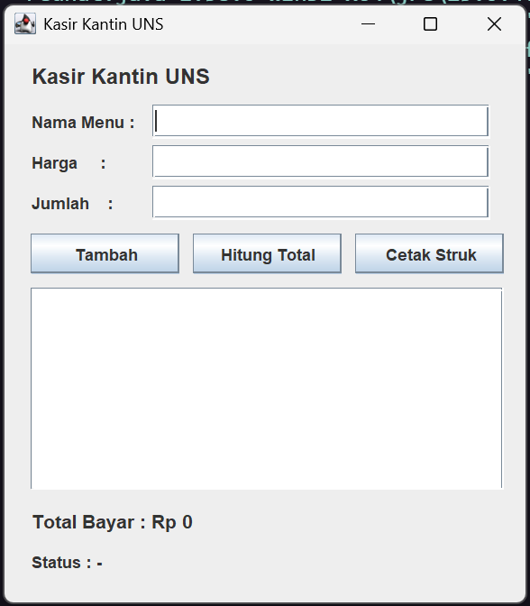

# Kasir Kantin UNS

Aplikasi kasir kantin sederhana berbasis **Java Swing**. Program ini
digunakan untuk memasukkan nama menu, harga, dan jumlah pesanan,
menghitung total pembayaran, serta mensimulasikan proses pencetakan
struk. Kode juga menerapkan konsep **Object-Oriented Programming
(OOP)**, **thread**, dan **event handling** pada Java.

## Struktur File

Semua file Java menggunakan package `labSesion3`.

``` text
labSesion3/
├── src/
│   ├── Pesanan.java
│   ├── Kasir.java
│   ├── MainKasir.java
│   ├── KasirFrame.java
│   └── MainGUI.java
└── README.md
└── assets
    └── gui-kasir-kantin-uns.png 
```

## Peranan Tiap Class

  -----------------------------------------------------------------------
  File                                Peranan
  ----------------------------------- -----------------------------------
  `Pesanan.java`                      Menyimpan subtotal serta
                                      menjalankan logika penambahan item,
                                      perhitungan diskon, dan reset
                                      pesanan.

  `Kasir.java`                        Merepresentasikan kasir sebagai
                                      thread yang melayani lima
                                      pelanggan.

  `MainKasir.java`                    Menjadi titik awal pengujian logika
                                      pesanan dan simulasi dua kasir
                                      melalui console.

  `KasirFrame.java`                   Membuat jendela GUI, komponen,
                                      event tombol, validasi input, dan
                                      simulasi pencetakan struk.

  `MainGUI.java`                      Menjadi titik awal untuk
                                      menjalankan aplikasi GUI.
  -----------------------------------------------------------------------

------------------------------------------------------------------------

## Penjelasan Alur Program Berdasarkan Tahap

### Tahap 1 --- Menguji Logika Pesanan

**File terkait: `Pesanan.java` dan `MainKasir.java`**

Pada tahap ini, program menguji proses penambahan item ke pesanan,
penghitungan subtotal, pemberian diskon, dan pengosongan pesanan.

#### 1.1. Implementasi class `Pesanan.java`

``` java
package labSesion3;

public class Pesanan {
    private static final double BATAS_DISKON = 50000;
    private static final double PERSEN_DISKON = 0.10;

    private double subtotal;

    public void tambahItem(double harga, int jumlah) {
        subtotal += harga * jumlah;
    }

    public double getSubtotal() {
        return subtotal;
    }

    public double hitungTotal() {
        if (subtotal > BATAS_DISKON) {
            return subtotal - (subtotal * PERSEN_DISKON);
        }
        return subtotal;
    }

    public void reset() {
        subtotal = 0;
    }
}
```

**Penjelasan kode:**

1.  `BATAS_DISKON` merupakan konstanta batas subtotal untuk mendapatkan
    diskon, yaitu Rp50.000.
2.  `PERSEN_DISKON` menyimpan persentase diskon sebesar 10% atau `0.10`.
3.  Atribut `subtotal` menyimpan akumulasi harga seluruh item pesanan.
    Atribut ini bersifat `private`, sehingga tidak dapat diubah secara
    langsung dari luar class.
4.  Method `tambahItem(double harga, int jumlah)` menambahkan hasil
    perkalian harga dan jumlah ke subtotal.
5.  Method `getSubtotal()` mengembalikan nilai subtotal sebelum diskon.
6.  Method `hitungTotal()` mengurangi subtotal sebesar 10% jika subtotal
    lebih dari Rp50.000. Jika subtotal tepat Rp50.000 atau kurang,
    diskon tidak diberikan.
7.  Method `reset()` mengembalikan subtotal menjadi nol.

#### 1.2. Pengujian pesanan pada `MainKasir.java`

Pengujian dilakukan melalui method `ujiPesanan()`.

``` java
private static void ujiPesanan() {
    System.out.println("=== TAHAP 1: UJI PESANAN ===");
    Pesanan pesanan = new Pesanan();

    pesanan.tambahItem(15000, 2);
    pesanan.tambahItem(5000, 3);

    System.out.println("Setelah 2 menu -> subtotal: "
            + FORMAT.format(pesanan.getSubtotal())
            + ", total: " + FORMAT.format(pesanan.hitungTotal()));

    pesanan.tambahItem(25000, 1);

    System.out.println("Setelah 3 menu -> subtotal: "
            + FORMAT.format(pesanan.getSubtotal())
            + ", total: " + FORMAT.format(pesanan.hitungTotal()));

    pesanan.reset();
    System.out.println("Setelah reset -> subtotal: "
            + FORMAT.format(pesanan.getSubtotal()));
}
```

**Penjelasan kode:**

1.  Objek `pesanan` dibuat dari class `Pesanan`.
2.  Program menambahkan dua item pertama, yaitu Rp15.000 sebanyak 2 buah
    dan Rp5.000 sebanyak 3 buah.
3.  Subtotal dan total pembayaran ditampilkan menggunakan `FORMAT`.
4.  Program menambahkan item ketiga, yaitu Rp25.000 sebanyak 1 buah.
5.  Setelah subtotal dan total ditampilkan kembali, method `reset()`
    dipanggil untuk mengosongkan pesanan.

Dengan data pengujian tersebut, subtotal setelah dua item adalah
Rp45.000. Setelah item ketiga ditambahkan, subtotal menjadi Rp70.000
sehingga total setelah diskon 10% menjadi Rp63.000.

### Tahap 2 --- Simulasi Dua Kasir Menggunakan Thread

**File terkait: `Kasir.java` dan `MainKasir.java`**

Tahap ini menunjukkan bagaimana dua kasir dapat menjalankan proses
pelayanan pelanggan secara bersamaan menggunakan multithreading.

#### 2.1. Implementasi class `Kasir.java`

``` java
package labSesion3;

public class Kasir extends Thread {
    private String nama;

    public Kasir(String nama) {
        this.nama = nama;
    }

    public String getNama() {
        return nama;
    }

    @Override
    public void run() {
        for (int i = 1; i <= 5; i++) {
            System.out.println("Kasir " + nama
                    + " melayani pelanggan ke-" + i);
            try {
                Thread.sleep(500);
            } catch (InterruptedException e) {
                Thread.currentThread().interrupt();
                return;
            }
        }
    }
}
```

**Penjelasan kode:**

1.  `extends Thread` menunjukkan bahwa class `Kasir` mewarisi class
    `Thread`, sehingga objeknya dapat dijalankan sebagai thread.
2.  Atribut `nama` menyimpan nama kasir dan bersifat `private`.
3.  Constructor `Kasir(String nama)` mengisi atribut nama ketika objek
    dibuat.
4.  Method `getNama()` digunakan untuk memperoleh nama kasir.
5.  Method `run()` berisi pekerjaan yang dilakukan oleh thread, yaitu
    melayani lima pelanggan.
6.  `Thread.sleep(500)` memberikan jeda 500 milidetik pada setiap
    iterasi.
7.  `InterruptedException` ditangani menggunakan `try-catch`. Jika
    thread mengalami interupsi, status interupsi dikembalikan dan method
    dihentikan.

#### 2.2. Menjalankan dua thread pada `MainKasir.java`

Proses pembuatan dan menjalankan dua kasir dilakukan melalui method
`simulasiKasir()`.

``` java
private static void simulasiKasir() {
    System.out.println("=== TAHAP 2: DUA KASIR ===");

    Kasir dina = new Kasir("Dina");
    Kasir eko = new Kasir("Eko");

    dina.start();
    eko.start();

    try {
        dina.join();
        eko.join();
    } catch (InterruptedException e) {
        Thread.currentThread().interrupt();
    }

    System.out.println("Semua pelanggan selesai dilayani");
}
```

**Penjelasan kode:**

1.  Dua objek kasir dibuat dengan nama `Dina` dan `Eko`.
2.  Method `start()` menjalankan masing-masing thread. Kedua kasir dapat
    melakukan proses pelayanan secara bersamaan.
3.  Method `join()` membuat thread utama menunggu sampai thread Dina dan
    Eko selesai.
4.  Setelah kedua thread selesai, program menampilkan pesan bahwa semua
    pelanggan telah selesai dilayani.

Urutan keluaran dari kedua kasir dapat berbeda-beda karena penjadwalan
thread ditentukan oleh sistem.

## OUTPUT:
**Percobaan 1**
```
=== TAHAP 1: UJI PESANAN ===
Setelah 2 menu -> subtotal: 45.000, total: 45.000
Setelah 3 menu -> subtotal: 70.000, total: 63.000
Setelah reset  -> subtotal: 0

=== TAHAP 2: DUA KASIR ===
Kasir Dina melayani pelanggan ke-1
Kasir Eko melayani pelanggan ke-1
Kasir Dina melayani pelanggan ke-2
Kasir Eko melayani pelanggan ke-2
Kasir Eko melayani pelanggan ke-3
Kasir Dina melayani pelanggan ke-3
Kasir Eko melayani pelanggan ke-4
Kasir Dina melayani pelanggan ke-4
Kasir Eko melayani pelanggan ke-5
Kasir Dina melayani pelanggan ke-5
Semua pelanggan selesai dilayani
```
**Percobaan 2**
```
=== TAHAP 1: UJI PESANAN ===
Setelah 2 menu -> subtotal: 45.000, total: 45.000
Setelah 3 menu -> subtotal: 70.000, total: 63.000
Setelah reset  -> subtotal: 0

=== TAHAP 2: DUA KASIR ===
Kasir Dina melayani pelanggan ke-1
Kasir Eko melayani pelanggan ke-1
Kasir Dina melayani pelanggan ke-2
Kasir Eko melayani pelanggan ke-2
Kasir Eko melayani pelanggan ke-3
Kasir Dina melayani pelanggan ke-3
Kasir Dina melayani pelanggan ke-4
Kasir Eko melayani pelanggan ke-4
Kasir Dina melayani pelanggan ke-5
Kasir Eko melayani pelanggan ke-5
Semua pelanggan selesai dilayani
```
### Tahap 3 --- Membuat Antarmuka GUI

**File terkait: `KasirFrame.java`**

Tahap ini membuat tampilan aplikasi menggunakan Java Swing. Komponen GUI
dibuat di dalam method `buatKomponen()`, sedangkan pengaturan awal
jendela dilakukan melalui constructor `KasirFrame()`.

#### 3.1. Constructor `KasirFrame()`

``` java
public KasirFrame() {
    setTitle("Kasir Kantin UNS");
    setSize(400, 450);
    setLayout(null);
    format.setMaximumFractionDigits(0);

    buatKomponen();
    pasangEvent();

    setDefaultCloseOperation(EXIT_ON_CLOSE);
    setLocationRelativeTo(null);
    setVisible(true);
}
```

**Penjelasan kode:**

1.  `setTitle()` mengatur judul jendela menjadi "Kasir Kantin UNS".
2.  `setSize()` mengatur ukuran awal jendela.
3.  `setLayout(null)` menggunakan pengaturan posisi komponen secara
    manual.
4.  `format.setMaximumFractionDigits(0)` membuat format angka tidak
    menampilkan angka desimal.
5.  `buatKomponen()` memanggil method untuk membuat dan menambahkan
    komponen GUI.
6.  `pasangEvent()` memasang aksi pada tombol.
7.  `setDefaultCloseOperation(EXIT_ON_CLOSE)` membuat aplikasi berhenti
    ketika jendela ditutup.
8.  `setLocationRelativeTo(null)` menempatkan jendela di tengah layar.
9.  `setVisible(true)` menampilkan jendela aplikasi.

#### 3.2. Membuat komponen GUI --- `buatKomponen()`

Berikut potongan kode yang membuat kolom input dan tombol.

``` java
private void buatKomponen() {
    JLabel lblJudul = new JLabel("Kasir Kantin UNS");
    lblJudul.setFont(
            lblJudul.getFont().deriveFont(Font.BOLD, 16f));
    lblJudul.setBounds(20, 10, 350, 25);

    JLabel lblMenu = new JLabel("Nama Menu :");
    lblMenu.setBounds(20, 45, 85, 25);
    txtMenu = new JTextField();
    txtMenu.setBounds(110, 45, 250, 25);

    JLabel lblHarga = new JLabel("Harga :");
    lblHarga.setBounds(20, 75, 85, 25);
    txtHarga = new JTextField();
    txtHarga.setBounds(110, 75, 250, 25);
    txtHarga.setToolTipText(
            "Isi angka tanpa titik pemisah ribuan, contoh: 15000");

    JLabel lblJumlah = new JLabel("Jumlah :");
    lblJumlah.setBounds(20, 105, 85, 25);
    txtJumlah = new JTextField();
    txtJumlah.setBounds(110, 105, 250, 25);

    btnTambah = new JButton("Tambah");
    btnTambah.setBounds(20, 140, 110, 30);

    btnHitung = new JButton("Hitung Total");
    btnHitung.setBounds(140, 140, 110, 30);

    btnCetak = new JButton("Cetak Struk");
    btnCetak.setBounds(260, 140, 110, 30);
```

Potongan berikut membuat area struk, label total, dan label status.

``` java
    areaStruk = new JTextArea();
    areaStruk.setEditable(false);
    areaStruk.setFont(
            new Font(Font.MONOSPACED, Font.PLAIN, 12));

    JScrollPane scrollStruk = new JScrollPane(areaStruk);
    scrollStruk.setBounds(20, 180, 350, 150);

    lblTotal = new JLabel("Total Bayar : Rp 0");
    lblTotal.setFont(
            lblTotal.getFont().deriveFont(Font.BOLD, 14f));
    lblTotal.setBounds(20, 340, 350, 25);

    lblStatus = new JLabel("Status : -");
    lblStatus.setBounds(20, 370, 350, 25);

    add(lblJudul);
    add(lblMenu);
    add(txtMenu);
    add(lblHarga);
    add(txtHarga);
    add(lblJumlah);
    add(txtJumlah);
    add(btnTambah);
    add(btnHitung);
    add(btnCetak);
    add(scrollStruk);
    add(lblTotal);
    add(lblStatus);
}
```

**Penjelasan kode:**

1.  `JLabel` digunakan untuk menampilkan judul, keterangan input, total
    pembayaran, dan status.
2.  `JTextField` digunakan sebagai tempat memasukkan nama menu, harga,
    dan jumlah.
3.  `JButton` menyediakan tiga aksi, yaitu Tambah, Hitung Total, dan
    Cetak Struk.
4.  `JTextArea` digunakan untuk menampilkan rincian pesanan.
    `setEditable(false)` mencegah pengguna mengubah isi area struk
    secara langsung.
5.  `JScrollPane` membungkus area struk agar isinya dapat digulir.
6.  `setBounds(x, y, lebar, tinggi)` mengatur posisi dan ukuran setiap
    komponen.
7.  `add()` memasukkan komponen ke dalam jendela.

### Tahap 4 --- Menangani Tombol, Validasi, dan Proses Struk

**File terkait: `KasirFrame.java`**

Tahap ini mengatur bagaimana aplikasi merespons tindakan pengguna,
memvalidasi input, memperbarui total pembayaran, dan menjalankan
simulasi pencetakan struk.

#### 4.1. Memasang event tombol --- `pasangEvent()`

``` java
private void pasangEvent() {
    btnTambah.addActionListener(e -> prosesTambah());
    btnHitung.addActionListener(e -> prosesHitung());

    btnCetak.addActionListener(e -> {
        new Thread(() -> {
            SwingUtilities.invokeLater(() -> {
                btnCetak.setEnabled(false);
                lblStatus.setText("Status : Mencetak struk...");
            });

            try {
                Thread.sleep(2000);
            } catch (InterruptedException ex) {
                Thread.currentThread().interrupt();
            }

            SwingUtilities.invokeLater(() -> {
                lblStatus.setText("Status : Struk selesai");
                btnCetak.setEnabled(true);
            });
        }).start();
    });
}
```

**Penjelasan kode:**

-   `addActionListener()` memasang event listener agar program
    menjalankan method tertentu ketika tombol diklik.
-   Tombol Tambah memanggil `prosesTambah()`.
-   Tombol Hitung Total memanggil `prosesHitung()`.
-   Tombol Cetak Struk membuat thread baru untuk menjalankan simulasi
    pencetakan.
-   `setEnabled(false)` menonaktifkan tombol cetak selama proses
    berlangsung agar tidak ditekan berulang kali.
-   `SwingUtilities.invokeLater()` digunakan untuk menjadwalkan
    perubahan komponen Swing pada Event Dispatch Thread.
-   `Thread.sleep(2000)` memberikan jeda dua detik.
-   Setelah jeda selesai, status diubah menjadi "Struk selesai" dan
    tombol cetak diaktifkan kembali.

#### 4.2. Menambahkan item dan validasi input --- `prosesTambah()`

Bagian pertama mengambil data dari kolom input dan memeriksa apakah
semua kolom sudah diisi.

``` java
private void prosesTambah() {
    String menu = txtMenu.getText().trim();
    String teksHarga = txtHarga.getText().trim();
    String teksJumlah = txtJumlah.getText().trim();

    if (menu.isEmpty()
            || teksHarga.isEmpty()
            || teksJumlah.isEmpty()) {
        JOptionPane.showMessageDialog(
                this,
                "Semua field harus diisi.",
                "Kesalahan",
                JOptionPane.ERROR_MESSAGE);
        return;
    }
```

Selanjutnya, harga dan jumlah diubah ke tipe data numerik dan
divalidasi.

``` java
    double harga;
    int jumlah;

    try {
        harga = Double.parseDouble(teksHarga);
        jumlah = Integer.parseInt(teksJumlah);
    } catch (NumberFormatException ex) {
        JOptionPane.showMessageDialog(
                this,
                "Harga dan jumlah harus berupa angka.\n"
                + "Contoh harga: 15000, contoh jumlah: 2",
                "Kesalahan",
                JOptionPane.ERROR_MESSAGE);
        return;
    }

    if (!(harga > 0) || jumlah <= 0) {
        JOptionPane.showMessageDialog(
                this,
                "Harga dan jumlah harus lebih dari 0.",
                "Kesalahan",
                JOptionPane.ERROR_MESSAGE);
        return;
    }
```

Setelah seluruh input dinyatakan valid, item dimasukkan ke pesanan dan
ditampilkan pada area struk.

``` java
    pesanan.tambahItem(harga, jumlah);

    areaStruk.append(String.format(
            "%-15s %d x %s = %s%n",
            menu,
            jumlah,
            format.format(harga),
            format.format(harga * jumlah)));

    txtMenu.setText("");
    txtHarga.setText("");
    txtJumlah.setText("");
    txtMenu.requestFocusInWindow();
}
```

**Penjelasan kode:**

1.  `getText()` mengambil teks dari setiap kolom input.
2.  `trim()` menghapus spasi di awal dan akhir teks.
3.  `isEmpty()` memeriksa apakah kolom masih kosong.
4.  `Double.parseDouble()` mengubah teks harga menjadi `double`,
    sedangkan `Integer.parseInt()` mengubah jumlah menjadi `int`.
5.  `try-catch` menangani kesalahan jika pengguna memasukkan karakter
    yang tidak dapat diubah menjadi angka.
6.  Kondisi `harga > 0` dan `jumlah > 0` memastikan nilai yang
    dimasukkan harus positif.
7.  `pesanan.tambahItem(harga, jumlah)` memperbarui subtotal pada objek
    `Pesanan`.
8.  `areaStruk.append()` menambahkan rincian item ke area struk.
9.  Ketiga kolom input dikosongkan setelah item berhasil ditambahkan.
10. `requestFocusInWindow()` mengembalikan fokus ke kolom nama menu agar
    pengguna dapat memasukkan item berikutnya.

#### 4.3. Menghitung total pembayaran --- `prosesHitung()`

``` java
private void prosesHitung() {
    lblTotal.setText(
            "Total Bayar : Rp "
            + format.format(pesanan.hitungTotal()));
}
```

**Penjelasan kode:**

1.  Method `pesanan.hitungTotal()` mengambil total pembayaran setelah
    aturan diskon diterapkan.
2.  `format.format()` mengubah angka ke format tampilan sesuai
    pengaturan lokal Indonesia.
3.  `lblTotal.setText()` memperbarui label total pembayaran pada GUI.

#### 4.4. Simulasi cetak struk

Proses simulasi pencetakan terdapat pada event tombol `btnCetak` di
method `pasangEvent()`.

Ketika tombol ditekan, program menjalankan thread baru, mengubah status
menjadi "Mencetak struk...", menunggu dua detik, lalu mengubah status
menjadi "Struk selesai". Selama proses tersebut tombol cetak
dinonaktifkan.

**Catatan:** fitur Cetak Struk pada kode ini masih berupa simulasi
status selama dua detik. Program belum mengirim data ke printer atau
membuka dialog pencetakan fisik.

------------------------------------------------------------------------

## Menjalankan Aplikasi GUI

**File terkait: `MainGUI.java`**

``` java
package labSesion3;

import javax.swing.SwingUtilities;

public class MainGUI {
    public static void main(String[] args) {
        SwingUtilities.invokeLater(KasirFrame::new);
    }
}
```

Method `main()` menjadi titik awal ketika aplikasi GUI dijalankan.
`SwingUtilities.invokeLater()` menjadwalkan pembuatan objek `KasirFrame`
pada Event Dispatch Thread, yaitu thread yang menangani pembuatan dan
pembaruan komponen Swing.

Untuk menjalankan pengujian console tahap 1 dan tahap 2, gunakan
`MainKasir.java`. Method `main()` pada file tersebut memanggil kedua
tahap secara berurutan:

``` java
public static void main(String[] args) {
    FORMAT.setMaximumFractionDigits(0);

    ujiPesanan();
    System.out.println();
    simulasiKasir();
}
```

## Konsep Java yang Digunakan

-   **Encapsulation:** atribut `subtotal` pada `Pesanan` dan `nama` pada
    `Kasir` menggunakan access modifier `private`.
-   **Inheritance:** class `Kasir` mewarisi `Thread`, sedangkan
    `KasirFrame` mewarisi `JFrame`.
-   **Method:** program memisahkan tugas ke dalam method seperti
    `tambahItem()`, `hitungTotal()`, `buatKomponen()`, dan
    `prosesTambah()`.
-   **Exception handling:** `try-catch` menangani input angka yang tidak
    valid dan interupsi thread.
-   **Multithreading:** dua objek `Kasir` berjalan sebagai thread
    terpisah, dan simulasi cetak struk juga menggunakan thread.
-   **Event handling:** `ActionListener` merespons klik tombol pada GUI.
-   **Java Swing:** komponen `JFrame`, `JLabel`, `JTextField`,
    `JButton`, `JTextArea`, dan `JScrollPane` digunakan untuk membangun
    antarmuka.
    
## Tampilan GUI

Berikut tampilan antarmuka aplikasi Kasir Kantin UNS:

